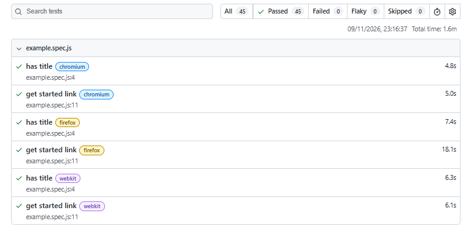

# Week 3 — Test Automation with Playwright

Automated the login test cases written in [Week 1](../week-01-foundations/test-cases/login-test-cases.md) using Playwright, and ran them on Chromium, Firefox and WebKit.

**Application under test:** [the-internet.herokuapp.com/login](https://the-internet.herokuapp.com/login) (public practice site)

## Result

All 45 test runs pass (15 tests x 3 browsers).



## What is covered

| File | What it tests |
|---|---|
| `tests/login.spec.js` | Main suite: 9 tests derived from the Week 1 test cases (see traceability below) |
| `tests/login-recorded.spec.js` | TC-013 recorded with `playwright codegen`, then cleaned up |
| `tests/locators-practice.spec.js` | Locator practice: checkboxes and dropdown |
| `tests/first.spec.js` | First test: page title and heading |
| `tests/example.spec.js` | Example generated by Playwright, kept as a smoke check |

### Traceability to Week 1 test cases

| Test case | Automated as | Notes |
|---|---|---|
| TC-013 | valid login reaches the secure area | Expects redirect to `/secure` and the success message |
| TC-001, TC-007 | invalid login (empty username / empty password) | Asserts current behaviour, see [BUG-001](../week-01-foundations/bug-reports/bug-001-empty-form-misleading-error.md) |
| TC-014, TC-015, TC-016 | invalid login (wrong password / wrong username / both) | Asserts current behaviour, see [BUG-002](../week-01-foundations/bug-reports/bug-002-user-enumeration-via-error-messages.md) |
| TC-020 | SQL injection string in username | Login is rejected, user stays on `/login` |
| TC-018 | password field masks the input | Checks `type="password"` |
| (new) | logout returns to the login page | Added while automating |

The invalid-login cases are data-driven: one array of inputs and expected messages, one test generated per row.

## Techniques used

- **Locators:** `getByRole`, `getByLabel` and CSS (`#flash`) instead of brittle XPath.
- **Auto-waiting and web-first assertions:** `expect(...).toBeVisible()`, `toHaveURL()`, `toContainText()`. No `waitForTimeout` anywhere.
- **Structure:** `test.describe` for grouping and `test.beforeEach` for the shared `goto('/login')`.
- **Data-driven tests:** a loop over test data that creates one named test per row.
- **Recording:** used `codegen` to get a first draft, then replaced generated selectors with readable ones.

## Configuration (`playwright.config.js`)

| Setting | Value | Why |
|---|---|---|
| `baseURL` | `https://the-internet.herokuapp.com` | Tests use `goto('/login')` instead of full URLs |
| `projects` | chromium, firefox, webkit | Cross-browser coverage |
| `retries` | 1 | A retry separates real failures from flaky ones on a shared public site |
| `screenshot` | `only-on-failure` | Evidence for bug reports |
| `video` | `retain-on-failure` | Reproduction steps for failures |
| `trace` | `on-first-retry` | Step-by-step trace to debug a failure |

## How to run

```bash
# install dependencies
npm install

# download the browsers Playwright needs (first time only)
npx playwright install

# run all tests on all three browsers
npx playwright test

# run one file on one browser
npx playwright test tests/login.spec.js --project=chromium

# open the HTML report of the last run
npx playwright show-report
```

## What I learned

- A failing test leaves a screenshot, video and trace, which can be attached to a bug report.
- On Windows the folder path case must match exactly (`E:\QA Job`), otherwise Playwright reports `did not expect test() to be called here`.
- The tests assert the application's current behaviour, including the behaviour that BUG-001 and BUG-002 describe. If those bugs are fixed, the expected messages must be updated.
- A shared public site can time out occasionally, so a single failure needs a re-run before it is called a bug.
